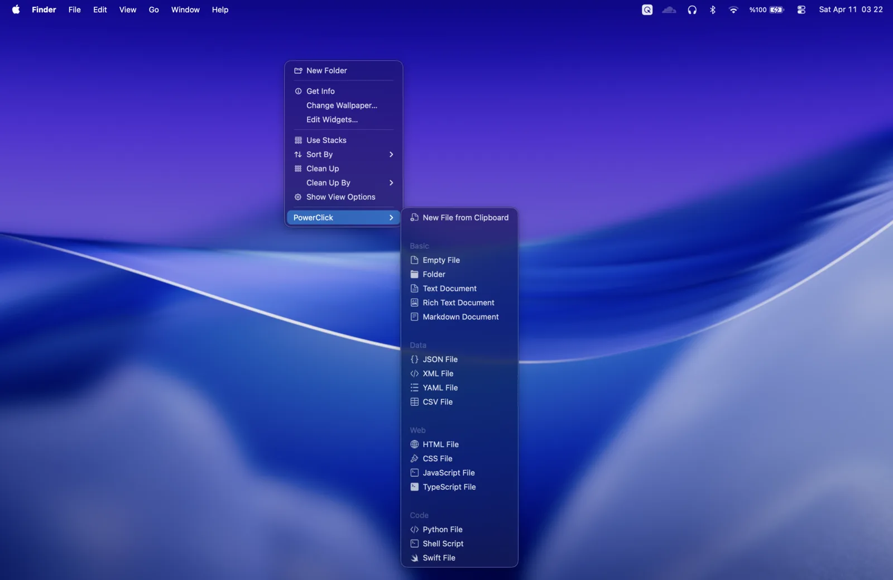
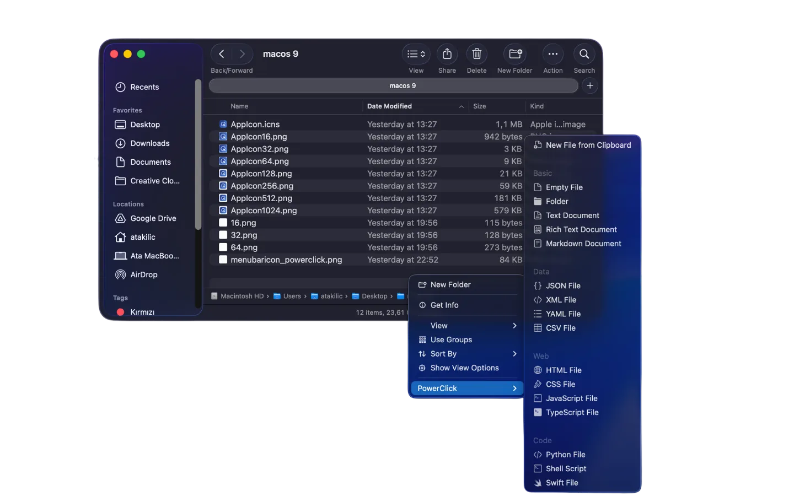
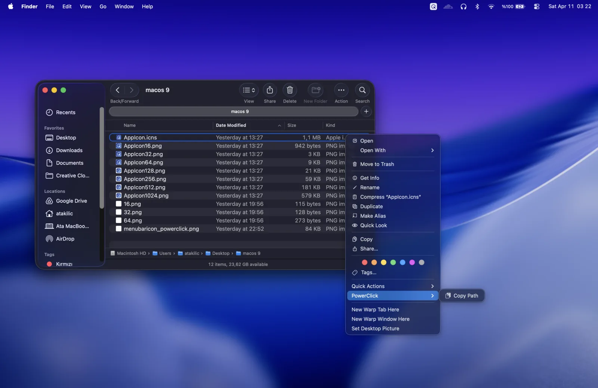

  

<h1 align="center">PowerClick</h1>

  The right-click menu Finder should have had. Convert, Compress, QR, New File, Copy Path, Batch Rename.

  
  
  

  

  

  <a href="https://www.youtube.com/watch?v=p6TFxQTHtAo">Watch the 44-second demo on YouTube</a>

Finder on macOS can't convert a file, has no New File command and no Cut for files, and it hides Copy Path behind the Option key. PowerClick adds **Convert**, **Compress for sharing**, **Read QR & Barcodes**, **New File**, **Copy Path**, **Cut & Move** and **Batch Rename** to the Finder right-click menu, and **ShortClick**, a radial menu you open with a shortcut anywhere in macOS. It is sandboxed, makes no network connections, and is a one-time purchase on the Mac App Store.

[Get PowerClick on the Mac App Store](https://apps.apple.com/app/id6762026455?mt=12) · [Website](https://powerclick.kilicov.dev/?utm_source=github&utm_medium=readme)

> This repository is PowerClick's home on GitHub: documentation, the changelog and the public issue tracker. PowerClick is not open source, and this repository contains no source code.

## Features

### Convert

Right-click a file, choose Convert and pick a format. The new file appears next to the original, which is never touched, and only formats your Mac can actually write are offered.

- **Photos:** HEIC, PNG, WebP, AVIF, TIFF, GIF, BMP, PSD and camera RAW to JPEG, PNG, HEIC, AVIF, TIFF, GIF, BMP or WebP, keeping metadata and orientation. Any image to an ICO or ICNS app icon.
- **Video:** MOV, MP4, M4V and AVI to MP4 (H.264 or HEVC) at 1080p or 720p, an animated GIF, or just the audio.
- **Audio:** MP3, WAV, AIFF, FLAC, OGG, Opus and M4A to AAC, Apple Lossless, FLAC, WAV or Opus.
- **Documents:** Word, RTF, OpenDocument, HTML and text into each other or into PDF. Markdown to PDF, HTML or Word. PDF to one image per page, or to text.

Long jobs run in the background, with progress and Cancel in the menu bar.

### Compress for sharing

Shrink videos, photos and PDFs to fit Discord (10 MB), email (25 MB), or to half their size. PowerClick works out the bitrate and resolution, and shows the size before and after.

### QR codes

Scan a QR code on your screen with a shortcut: drag around it or click it (macOS 14 or later). Read QR codes and barcodes in images and PDFs from Finder, and create your own for links, text or Wi-Fi. Every link is checked on your Mac for look-alike domains, hidden shorteners and other phishing tricks before you open it.

### Translate & Transcribe

Select text in almost any app and choose **Services > Translate with PowerClick** to translate it on-device (macOS 15 or later). Right-click a recording or a video and choose **Transcribe** for a text file, subtitles (.srt), or text copied straight to the clipboard (macOS 26 or later, in the languages Apple's speech models support).

### ShortClick

Press a shortcut, or hold Command and Shift and right-click, and a radial menu opens under the cursor, anywhere in macOS. Flick toward an item to launch a favorite app, paste a snippet, reuse something from your clipboard history, run one of your Shortcuts, scan a QR code on screen or snap the frontmost window.

### New File

Create a new file right where you are in Finder. Built-in templates cover text, data, web and code files, and you can add your own file types with their own extension, content and icon. New File from Clipboard turns what you copied into a file and picks the type from the content: JSON becomes .json, a table .csv, a link .webloc, an image .png. Smart naming prevents overwriting a file that already exists.

  

### Copy Path & file info

Copy a file's full path, parent folder path, name, name without extension or extension. You can also copy its size, its creation and modification dates, and the dimensions of an image.

  

### Cut & Move

Cut a file or folder in Finder and choose Move Here in the destination folder. Or send it straight to Desktop, Documents, Downloads, a recent destination or a favorite folder with Move To and Copy To. If an item with the same name is already there, choose Replace or Keep Both.

### Batch Rename

Select several files and rename them in one step. Add a prefix or suffix, replace text, insert dates and sequence numbers, trim whitespace, remove special characters, and convert names to lowercase, UPPERCASE, Title Case, kebab-case or snake_case.

### Open in editor

Open selected files and folders in VS Code or another supported code editor straight from Finder, with no dragging and no terminal commands.

### Cloud folders

PowerClick works in iCloud Drive, Dropbox, Google Drive, OneDrive and Box folders. Grant access once and PowerClick remembers it. You can also add your Home folder, project folders and external locations, and manage folder access from the app at any time.

### Snippets & clipboard history

Save text you reuse, such as code blocks, email replies, terminal commands and templates, and pick recent clipboard text from the menu bar. Both are stored only on your Mac.

### Undo

Moved or renamed something by mistake? Undo Last Action reverses the last supported move or rename with one click. Files go to the Trash instead of being deleted, and anything you edited since is left alone.

### Appearance

Since version 2.2.0 you can choose Light, Dark or Auto (Auto follows macOS), one of nine theme colors, and a Clear or Tinted Liquid Glass look.

## Requirements

- macOS 13 Ventura or later
- Apple silicon or Intel Mac (PowerClick is a Universal app)
- The PowerClick Finder extension enabled in System Settings
- Translate needs macOS 15 or later, Transcribe macOS 26 or later, and Scan QR on Screen macOS 14 or later

## Getting started

1. Install PowerClick from the [Mac App Store](https://apps.apple.com/app/id6762026455?mt=12).
2. Open PowerClick. It lives in the menu bar.
3. Enable the Finder extension: open **System Settings > Privacy & Security > Extensions > Finder Extensions** and turn on PowerClick. The menu bar icon turns green when the extension is active.
4. Right-click a file, a folder or an empty area of a Finder window and open the PowerClick submenu.

## FAQ

**Is PowerClick a subscription?**
No. PowerClick is a one-time purchase on the Mac App Store; the App Store shows the price for your country. There is no subscription and there are no in-app purchases.

**Does it work in iCloud Drive, Dropbox and other cloud folders?**
Yes. PowerClick works in iCloud Drive, Dropbox, Google Drive, OneDrive and Box folders. Grant access once and PowerClick remembers it.

**Does PowerClick collect any data?**
No. PowerClick is sandboxed, makes no network requests, and has no analytics or tracking. Files are converted, compressed, scanned and transcribed on your Mac and never uploaded. Your clipboard history, snippets and settings stay on your Mac. See [PRIVACY.md](PRIVACY.md).

**Why do I need to enable the Finder extension?**
macOS keeps every Finder extension off until you turn it on yourself. PowerClick's right-click menu comes from its Finder extension, so the menu appears only after you enable it in System Settings.

**Does PowerClick replace Finder?**
No. PowerClick adds its own submenu to Finder's right-click menu. Every built-in Finder command stays where it was.

**How do I get a refund?**
Apple handles all Mac App Store purchases and refunds. You can request a refund at [reportaproblem.apple.com](https://reportaproblem.apple.com).

## Support & feedback

- Found a bug? [Open a bug report](https://github.com/atakilicov/powerclick/issues/new?template=bug_report.yml).
- Have an idea? [Request a feature](https://github.com/atakilicov/powerclick/issues/new?template=feature_request.yml).
- Questions and setup help: [Discussions](https://github.com/atakilicov/powerclick/discussions).
- Anything you'd rather not post publicly: [ata@kilicov.dev](mailto:ata@kilicov.dev).

[SUPPORT.md](SUPPORT.md) lists what to include in a bug report.

## Languages

PowerClick is available in 23 languages: English, Spanish, German, French, Portuguese (Brazil), Portuguese (Portugal), Turkish, Dutch, Italian, Japanese, Korean, Russian, Simplified Chinese, Traditional Chinese, Polish, Czech, Ukrainian, Hungarian, Romanian, Greek, Swedish, Danish and Norwegian.

## Changelog

**2.5.0** is the biggest update yet: Convert, Compress for sharing, a QR toolkit with on-screen scanning, Translate and Transcribe, and ten new languages for 23 in total. It is in App Store review.

See [CHANGELOG.md](CHANGELOG.md) for the full version history, or [Releases](https://github.com/atakilicov/powerclick/releases).

---

PowerClick is made by [Kilicov](https://www.kilicov.dev/?utm_source=github&utm_medium=readme), an independent app studio in Istanbul.

PowerClick is not open source. This repository contains documentation and media only. See [LICENSE.md](LICENSE.md).
